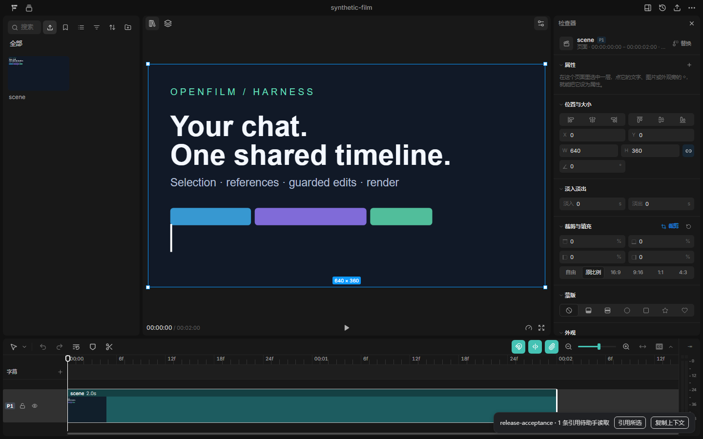

# OpenFilm Harness

**Edit video from your existing agent conversation.** OpenFilm supplies the canvas, timeline, inspector and export; this bridge connects the editor to Codex and other MCP clients.

[中文说明](README.zh-CN.md) · [Download v0.2.0](https://github.com/TravorShelby/openfilm-harness/releases/tag/v0.2.0) · [OpenFilm](https://github.com/openfilm/openfilm)

An independent MIT integration by [TravorShelby](https://github.com/TravorShelby), built on the unmodified OpenFilm `0.2.7` runtime. This repository contains the bridge and host adapters. OpenFilm itself is developed upstream.



Actual editor screenshot from the synthetic release check. The bottom-right bridge panel has one selected reference waiting for the assistant.

## What it does

- Opens OpenFilm Studio alongside the current agent chat.
- Reads the selected clips, playhead, timeline revision and queued references.
- Keeps references isolated between conversation/project bindings.
- Applies timeline edits with revision checks, locked-track protection and request receipts.
- Undoes one bridge edit while refusing to overwrite subsequent changes.
- Uses OpenFilm's official frame checks and renderer.

The editor's **引用所选 / Reference in chat** action queues context for the assistant's next MCP call. Tell the assistant what to change in your existing chat. It does not automatically send a message or start another model session.

## Quick start

Requires **Node.js 22.18+**, **FFmpeg/ffprobe on PATH**, and the **Chromium build matching the pinned Playwright runtime**. Keep the installation directory in a permanent location.

```sh
git clone https://github.com/TravorShelby/openfilm-harness.git
cd openfilm-harness
npm ci --ignore-scripts
node node_modules/playwright-core/cli.js install chromium
node node_modules/openfilm/bin/openfilm.mjs doctor
```

On Linux, Chromium may also require system libraries: use Playwright's documented `install --with-deps chromium` setup. Install FFmpeg through your OS package manager. The plugin does not bundle Chromium or FFmpeg.

### Codex on Windows

Run in PowerShell from this repository:

```powershell
.\install.ps1 -Mode Native
```

The installer registers the included local marketplace and installs `openfilm-harness@openfilm-harness-local`. It backs up existing settings and only removes an old direct MCP registration if that registration points to this exact server. Restart or refresh Codex after installation.

For Codex versions without native plugins, remove any native installation first, then run `./install.ps1 -Mode Mcp`. An existing global `openfilm-codex` Skill is preserved unless you request `-ReplaceExistingSkills`, which backs it up before replacement.

### Other hosts and manual configuration

```sh
node configure.mjs codex
node configure.mjs claude-code
node configure.mjs cursor
node configure.mjs opencode
node configure.mjs gemini
```

Run the command for your host and merge its output into that host's MCP configuration. The printer does not rewrite settings. `generic` and `dsh` print a generic stdio MCP descriptor; DSH's native profile format is not verified. Make `skills/openfilm-codex` available through your host's supported Skill mechanism.

The source also includes Codex/Claude compatibility manifests, local marketplaces and a Gemini extension descriptor. Host-native acceptance is described below; a manifest alone does not establish compatibility.

### Use it

Ask in your current conversation:

> Use OpenFilm to open my project at `<absolute folder containing film.html>`. Read the current timeline, selection and playhead before editing.

The assistant calls `openfilm_open_editor`, keeps its binding ID and opens the returned private URL in a host browser pane or external browser. Select a clip, click **引用所选**, then describe your intended edit in chat. The plugin's icon is not a one-click editor launcher.

The bridge operates on OpenFilm projects. For a new project, use OpenFilm's **Projects → New project** flow. Run `node manual.mjs` for its authoring manual or `node manual.mjs --skill motion-graphics` for a built-in film Skill.

## Host support

| Host | Included adapter | Verified scope |
| --- | --- | --- |
| Codex | Native plugin, marketplace, Skill, MCP, Windows installer | Windows native discovery, open/context and browser panel verified |
| Claude Code | Plugin manifest, marketplace, MCP, Skill | Protocol interoperability tested; native loading unverified |
| Gemini CLI | Extension manifest, MCP | Native extension loading unverified |
| Cursor | MCP configuration printer | Actual host unverified |
| OpenCode | MCP configuration printer, portable Skill | Actual host unverified |
| DSH / other MCP clients | Generic stdio descriptor | Native profile format and embedded UI unverified |

macOS and Linux native-host behavior has not been manually accepted. Embedded UI depends on the host; an external browser is the handoff when no browser panel is available.

## Tools

| MCP tool | Purpose |
| --- | --- |
| `openfilm_open_editor` | Bind a real project and open Studio |
| `openfilm_get_context` | Read timeline, revision, selection, references and command receipt |
| `openfilm_clear_references` | Acknowledge only handled references |
| `openfilm_editor_command` | Queue a seek, clip selection or range display |
| `openfilm_patch_project` | Apply an edit at an exact observed revision |
| `openfilm_get_operation` | Recover an edit's persisted or uncertain result |
| `openfilm_undo_operation` | Undo one edit if no later timeline edit exists |
| `openfilm_check_project` | Run OpenFilm's official look checks |
| `openfilm_render_project` | Run the official renderer |
| `openfilm_stop_editor` | Stop the shared editor when idle |

## Collaboration and recovery

Pass the explicit `bindingId` returned by opening the project. Only an actual supplied `sessionId`, `CODEX_THREAD_ID` or `OPENFILM_SESSION_ID` creates a persisted conversation binding. Otherwise the binding lasts for the MCP connection; reconnecting does not recover the same chat identity.

An edit requires the observed `baseRevision` and a UUID `requestId`. Identical completed requests return their saved result; the same ID cannot be reused for a different edit. A `prepared` receipt means the outcome is uncertain: reread the project before proceeding. After a revision conflict, read and merge the new state. Undo refuses to overwrite later edits.

Guards cover **`film.html`**, not transactions across arbitrary assets or scene files. The bridge and Studio share OpenFilm's in-process edit queue; this does not add an operating-system file lock against unrelated external editors.

Selection, references and command receipts are memory-only. Reopen after a worker restart; bindings and edit receipts persist. Each binding accepts one live editor tab. A command receipt acknowledges delivery, so confirm the resulting selection and rendered pixels when needed.

Long renders must fit the host's MCP timeout. The direct Codex config sets 1,800 seconds; native manifests use the host default. A timeout does not cancel a render or prove that it failed. Inspect the export before retrying.

## Runtime and privacy

- Pinned dependencies: OpenFilm `0.2.7`, MCP SDK `1.32.2`, Zod `4.6.7`.
- Private data lives in `OPENFILM_BRIDGE_HOME`, or `%LOCALAPPDATA%/OpenFilm-Harness` on Windows / `~/.local/share/OpenFilm-Harness` elsewhere. Keep it out of Git.
- Studio uses random loopback ports and a separate data home. It can reuse upstream's shared media settings.
- Control and editor-page credentials are separate; untrusted origins and page-to-control escalation are refused. Launch URLs contain temporary credentials: keep them private.
- The bridge does not create or modify `.film/chat/`. Model calls remain with the existing host. Separately configured media providers may charge for generation.

See [NOTICE.md](NOTICE.md) for upstream attribution and dependency scope.

## Development

```sh
npm ci --ignore-scripts
node node_modules/playwright-core/cli.js install chromium
npm run check
npm test
```

The existing eight tests exercise real OpenFilm code, headless Chromium, two stdio MCP clients, reference isolation, revision conflicts, locks, idempotency, undo and origin checks. They use isolated synthetic projects. [Validation scope](docs/VALIDATION.md) distinguishes automated protocol tests from native-host acceptance.

For a bundled-dependency archive, create `dist`, then run `npm run pack:local`. Extract the release archive into a permanent location; it creates a `package` directory. It includes npm dependencies, not browsers or FFmpeg. Validate a fresh extraction with:

```sh
node verify-release.mjs --out <new-absolute-output-directory>
```

This generates a synthetic film, editor screenshot, official frame checks, a short render and a full-decode receipt. It refuses to overwrite an existing output directory.

Contributions: [CONTRIBUTING.md](CONTRIBUTING.md). License: [MIT](LICENSE). This is an independent integration and is not affiliated with OpenFilm, OpenAI or other host vendors.
