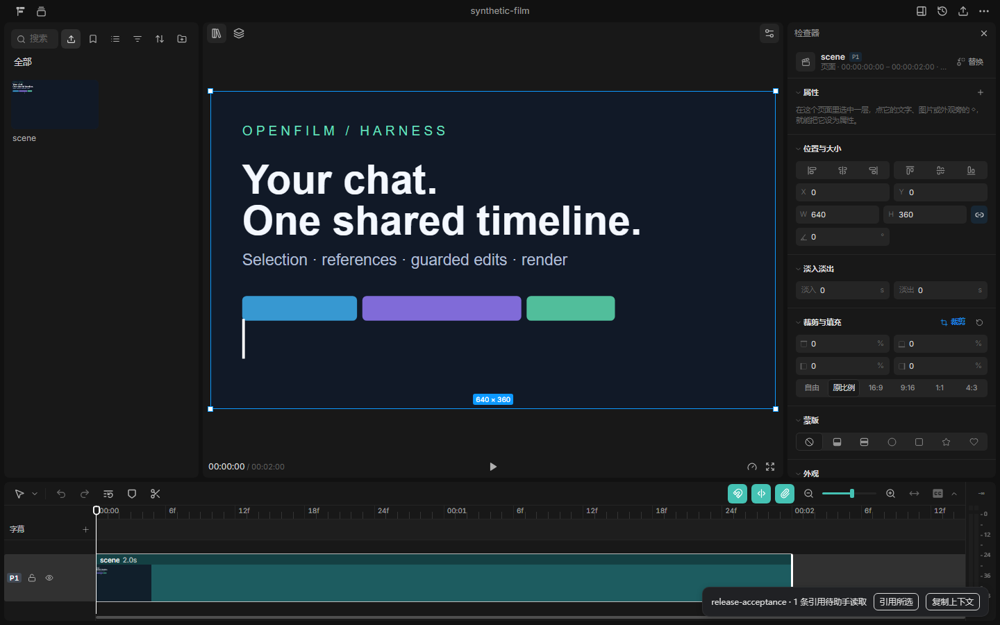

# OpenFilm Harness

**在现有 Agent 聊天里剪视频。** OpenFilm 提供画布、时间线、检查器和导出，这个插件把编辑器接入 Codex 与其他 MCP 客户端。

[English](README.md) · [下载 v0.2.0](https://github.com/TravorShelby/openfilm-harness/releases/tag/v0.2.0) · [OpenFilm 原项目](https://github.com/openfilm/openfilm)

这是 [TravorShelby](https://github.com/TravorShelby) 开发的独立 MIT 集成，依赖未修改的 OpenFilm `0.2.7`。本仓库发布桥接代码和宿主适配，OpenFilm 编辑器由上游开发维护。



截图来自本次合成工程验收，右下角桥接面板中有一条选区引用等待助手读取。

## 能做什么

- 在当前聊天旁打开 OpenFilm Studio。
- 读取选中片段、播放头、时间线版本和待处理引用。
- 按会话与工程绑定隔离引用。
- 修改时间线时检查版本、保护锁定轨道、保存请求回执。
- 撤销一次插件修改，并拒绝覆盖之后发生的编辑。
- 调用 OpenFilm 官方 look 检查与 render 导出。

编辑器里的「引用所选 / Reference in chat」会把上下文排队，供助手下一次 MCP 调用读取。选好片段后，在原聊天里说要怎么改；引用按钮不会自动发送聊天消息或启动新的模型会话。

## 安装

需要 **Node.js 22.18+**、**PATH 中可用的 FFmpeg/ffprobe**，以及**与固定 Playwright 版本匹配的 Chromium**。请把源码或解压包放在长期保留的位置。

```sh
git clone https://github.com/TravorShelby/openfilm-harness.git
cd openfilm-harness
npm ci --ignore-scripts
node node_modules/playwright-core/cli.js install chromium
node node_modules/openfilm/bin/openfilm.mjs doctor
```

FFmpeg 请按操作系统自行安装。Linux 的 Chromium 还可能需要系统库，可使用 Playwright 文档中的 `install --with-deps chromium`。发布包包含 npm 依赖，不含浏览器与 FFmpeg。

### Windows + Codex

在仓库目录中用 PowerShell 执行：

```powershell
.\install.ps1 -Mode Native
```

安装器会添加仓库内的本地插件市场，安装 `openfilm-harness@openfilm-harness-local`，并备份原设置。只有旧直接 MCP 注册指向同一个 server 文件时，才会移除该注册。安装后刷新或重启 Codex。

旧版 Codex 若不支持原生插件，可先卸载原生安装，再运行 `./install.ps1 -Mode Mcp`。已有全局 `openfilm-codex` Skill 默认保留；显式使用 `-ReplaceExistingSkills` 时，先备份再更新。

### 其他宿主

```sh
node configure.mjs claude-code
node configure.mjs cursor
node configure.mjs opencode
node configure.mjs gemini
```

选择对应命令，将输出合并到宿主 MCP 设置；打印器不会重写设置。`codex` 输出 TOML，`generic` 和 `dsh` 输出通用 stdio MCP 描述；DSH 原生 profile 格式未确认。再按宿主支持的方式加载 `skills/openfilm-codex`。

仓库也提供 Codex / Claude 插件描述、本地市场和 Gemini 扩展描述，实际验证范围见下表。

## 使用

在当前聊天中说：

> 用 OpenFilm 打开工程 `<包含 film.html 的绝对目录>`，先读取时间线、当前选区和播放位置，再根据我的要求修改。

助手调用 `openfilm_open_editor` 后，会保留绑定 ID，并在宿主浏览器面板或普通浏览器打开私有编辑器链接。选中片段，点击「引用所选」，然后回到原聊天提出修改要求。

当前插件图标不提供一键打开编辑器。新工程可以通过 OpenFilm 的 **Projects → New project** 创建。`node manual.mjs` 可查看固定版本的创作手册，`node manual.mjs --skill motion-graphics` 可查看内置视频 Skill。

## 适配与验收范围

| 宿主 | 已提供 | 实际验证 |
| --- | --- | --- |
| Codex | 原生插件、市场、Skill、MCP、Windows 安装器 | Windows 原生工具发现、打开、上下文读取和浏览器面板已验证 |
| Claude Code | 插件描述、市场、MCP、Skill | 协议互通已测，原生加载未验收 |
| Gemini CLI | 扩展描述、MCP | 原生加载未验收 |
| Cursor | MCP 配置打印器 | 实际客户端未验收 |
| OpenCode | MCP 配置打印器、通用 Skill | 实际客户端未验收 |
| DSH / 其他客户端 | 通用 stdio 描述 | 原生配置格式和内嵌 UI 未验收 |

macOS / Linux 原生宿主尚未人工验收。是否可内嵌编辑器取决于宿主能力，没有浏览器面板时使用普通浏览器。

## 十个工具

| MCP 工具 | 用途 |
| --- | --- |
| `openfilm_open_editor` | 绑定真实工程并打开编辑器 |
| `openfilm_get_context` | 读取时间线、版本、选区、引用和指令回执 |
| `openfilm_clear_references` | 清除已经处理的引用 |
| `openfilm_editor_command` | 请求跳转、选择片段或显示范围 |
| `openfilm_patch_project` | 基于精确版本修改时间线 |
| `openfilm_get_operation` | 查询修改结果或不确定状态 |
| `openfilm_undo_operation` | 无后续修改时撤销一次编辑 |
| `openfilm_check_project` | 官方帧检查 |
| `openfilm_render_project` | 官方导出 |
| `openfilm_stop_editor` | 空闲时关闭共享编辑器 |

## 协作边界

后续操作应显式传入打开工程返回的 `bindingId`。只有宿主提供真实 `sessionId`、`CODEX_THREAD_ID` 或 `OPENFILM_SESSION_ID` 时，才持久绑定到会话；否则绑定仅对当前 MCP 连接有效。

修改需要当前 `baseRevision` 和 UUID `requestId`。已完成的同一请求可返回原回执；不同修改不能复用 ID。`prepared` 表示结果尚不确定，应复读工程；版本冲突也需要先读取、再合并。撤销会拒绝覆盖后续修改。

保护范围是 **`film.html`**，不是全部素材和场景文件的事务。插件与 Studio 使用同一进程内的编辑队列，不能阻止其他程序直接写文件。选区、引用和指令回执只保存在内存中，重启需重开编辑器；绑定和修改回执持久保留。

长导出需要足够的 MCP 超时。直接 Codex 配置设置 1,800 秒，原生描述使用宿主默认值。超时不代表导出取消或失败，重试前应检查实际输出。

## 数据与依赖

- 固定 OpenFilm `0.2.7`、MCP SDK `1.32.2`、Zod `4.6.7`。
- 私有状态保存在 `OPENFILM_BRIDGE_HOME`，默认 Windows 为 `%LOCALAPPDATA%/OpenFilm-Harness`，其他平台为 `~/.local/share/OpenFilm-Harness`；不要提交到 Git。
- 编辑器使用随机本地端口与独立数据目录。控制凭据与页面凭据分离，临时启动 URL 需要保密。
- 插件不读写 `.film/chat/`，模型请求留在当前宿主。另行配置的媒体服务可能产生费用。
- 上游与依赖的版权说明见 [NOTICE.md](NOTICE.md)。

## 开发与验证

```sh
npm ci --ignore-scripts
node node_modules/playwright-core/cli.js install chromium
npm run check
npm test
```

八项既有测试覆盖真实 OpenFilm、Chromium、两个 stdio MCP 客户端、引用隔离、版本冲突、锁、幂等、撤销和来源检查，全部使用独立合成工程。详细边界见 [验证记录](docs/VALIDATION.md)。

创建 `dist` 目录后执行 `npm run pack:local`，即可生成含 npm 依赖的离线包。解压会得到 `package` 目录；在其中运行 `node verify-release.mjs --out <新的绝对输出目录>`，可完成合成工程、截图、官方 look、短片导出及全片解码检查，脚本拒绝覆盖已有输出目录。

贡献说明：[CONTRIBUTING.md](CONTRIBUTING.md)。许可证：[MIT](LICENSE)。本项目是独立集成，与 OpenFilm、OpenAI 及其他宿主厂商无隶属关系。
